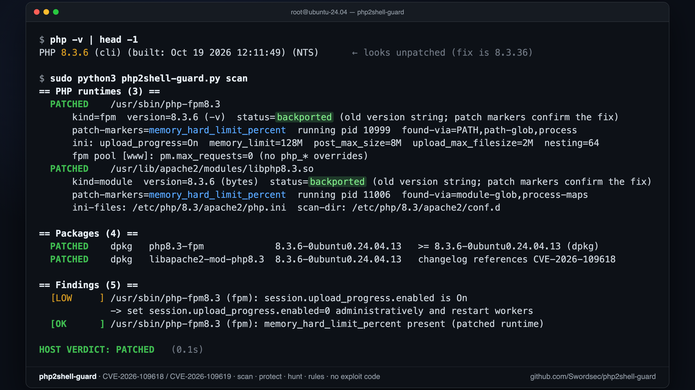

# php2shell-guard

Scanner, interim-mitigation and incident-hunting tool for **php2shell**, the pair of
critical unauthenticated remote code execution bugs in the PHP runtime:

| CVE | Name | CVSS v4 |
|---|---|---|
| CVE-2026-109618 | RCE via out-of-memory corruption | 9.2 |
| CVE-2026-109619 | RCE via stale global state | 9.2 |

Single-file Python 3 (standard library only), plus a POSIX `sh` quick check for hosts
without Python. **No exploit code.** Nothing in this repository attempts to trigger
either vulnerability; the `remote` mode is a passive banner check with an optional
inert WAF coverage probe.

```bash
sudo python3 php2shell-guard.py scan                 # am I patched? (binaries, packages, workers, ini, FPM pools, Docker)
sudo python3 php2shell-guard.py protect --apply      # php.net interim mitigations, with --rollback
sudo python3 php2shell-guard.py hunt                 # was I hit? (logs, session files, webroots, worker children)
python3 php2shell-guard.py remote -f hosts.txt       # fleet banner check (your own hosts)
python3 php2shell-guard.py rules modsecurity         # WAF / proxy / IDS snippets
sh quickcheck.sh                                     # no python? 10-second answer
```

## Why another php2shell tool

Most public repositories are either exploit PoCs or remote banner scanners. Neither
answers the question an operator actually has at 3 a.m.: *is the PHP that serves my
traffic fixed, and if not, what do I do in the next ten minutes?* The banner is hidden
by CDNs, Debian/Ubuntu/RHEL backports keep the old version string (Ubuntu 24.04's fixed
build still reports `PHP 8.3.6`), the CLI `php -v` is often not the binary behind
Apache or PHP-FPM, and a restarted package is not the same as a restarted worker.

php2shell-guard works **on the host**, from the inside, and uses three independent
signals so that a backport is never misreported as vulnerable and an old binary is
never misreported as safe:

| Signal | What it proves | Covers |
|---|---|---|
| **Patch markers in the binary** | The build contains the fix, whatever its version string says. `memory_hard_limit_percent` is a new INI directive added by the full fix (8.2.35 / 8.3.36 / 8.4.27 / 8.5.12). `zend_mm_safe_error_ex` is an exported symbol added by the minimal 7.4 / 8.0 / 8.1 backports that distributions ship (confirmed on RHEL/Alma `php-8.0.30-8.el9_8.1`). | every SAPI, every vendor, Apache `.so` modules, running workers (`/proc/<pid>/exe` and `maps`) |
| **Package version** | dpkg / rpm / apk / pacman / brew version compared with dpkg and rpm semantics against known fixed builds, and the package changelog grepped for the CVE ids. | distro backports |
| **Upstream version** | `php -v` (or the compile-time `X-Powered-By: PHP/x.y.z` literal for `.so` files) against the fixed-release table. | source builds, Docker official images, Homebrew, Windows |

It then reads the **effective** configuration per SAPI (`php -i`, `php-fpm -i`, FPM
`-tt` pool dumps, static resolution of Debian's per-SAPI `php.ini` + `conf.d`, Apache
`php_admin_*` directives) and flags the settings php.net names in its interim guidance.

## Install

```bash
git clone https://github.com/Swordsec/php2shell-guard.git
cd php2shell-guard
sudo python3 php2shell-guard.py scan
```

Or drop the two files on a host with `scp`. Requirements: Python 3.8+ (`scan`,
`protect`, `hunt`, `remote`, `rules`) or any POSIX `sh` (`quickcheck.sh`). Root is
not required but without it process maps, some binaries and FPM pool dumps are not
readable, and `protect --apply` cannot write configuration.

## Commands

### `scan` — host audit



```
$ sudo python3 php2shell-guard.py scan
== PHP runtimes (3) ==
  PATCHED    /usr/sbin/php-fpm8.3
      kind=fpm  version=8.3.6 (-v)  status=backported (version string predates the fix; patch markers confirm the build)
      patch-markers=memory_hard_limit_percent  running pid 10999  found-via=PATH,path-glob,process
      ini: upload_progress=On  memory_limit=128M  post_max_size=8M  upload_max_filesize=2M  nesting=64
      fpm pool [www]: pm.max_requests=0 (no php_* overrides)
  PATCHED    /usr/lib/apache2/modules/libphp8.3.so
      kind=module  version=8.3.6 (bytes)  status=backported (...)
      patch-markers=memory_hard_limit_percent  running pid 11006  found-via=module-glob,process-maps
      ini-files: /etc/php/8.3/apache2/php.ini  scan-dir: /etc/php/8.3/apache2/conf.d

== Packages (4) ==
  PATCHED    dpkg   php8.3-fpm   8.3.6-0ubuntu0.24.04.13   8.3.6-0ubuntu0.24.04.13 >= 8.3.6-0ubuntu0.24.04.13 (dpkg)
  ...
HOST VERDICT: PATCHED
```

What it looks at:

* every PHP executable on `PATH` and in ~60 known locations (Debian/Ubuntu, RHEL family,
  Remi, cPanel EA4, Plesk, LiteSpeed/CyberPanel, DirectAdmin, Docker official images,
  Homebrew, MAMP/XAMPP/ServBay, FreeBSD, Windows XAMPP/Laragon/WAMP);
* Apache `libphp*.so` modules, from `LoadModule` lines and from the memory maps of running
  `apache2`/`httpd` processes;
* the binary behind every running `php-fpm`, `php-cgi`, `lsphp`, `frankenphp` worker, and
  whether that binary was **replaced since the worker started** (`(deleted)` in `/proc`),
  which means "patched on disk, still vulnerable in memory";
* dpkg / rpm / apk / pacman / Homebrew package state, with changelog CVE references;
* effective INI per SAPI: `session.upload_progress.enabled`, `fatal_error_backtraces`,
  `memory_limit`, `post_max_size`, `upload_max_filesize`, `max_input_nesting_level`,
  plus FPM pool `php_admin_*` overrides and `pm.max_requests`;
* Apache `php_value`/`php_admin_value`/`RLimitMEM` directives (php.net warns against
  `RLIMIT_AS`/`RLIMIT_DATA`: they cause exactly the allocation failure the bug needs);
* with `--docker`, every running container: PHP version and patch markers inside it.

Severity drops automatically once a runtime is confirmed patched (e.g. upload progress
still enabled becomes LOW, as php.net suggests keeping it off anyway).

Options: `--json`, `-o report.json`, `--docker`, `--no-config` (faster). Exit code 0
patched, 1 vulnerable, 2 undetermined.

### `protect` — interim mitigations with rollback

Applies the php.net advisory's "if you cannot update immediately" measures, in the
places that apply **before request parsing** (the advisory is explicit that `ini_set()`
and `.user.ini` do not help). Dry run by default.

```bash
sudo python3 php2shell-guard.py protect                               # show the plan
sudo python3 php2shell-guard.py protect --apply --restart             # upload-progress off (+ 8.5 backtraces off)
sudo python3 php2shell-guard.py protect --apply --post-max 32M --memory-unlimited --restart
sudo python3 php2shell-guard.py protect --rollback --apply --restart  # undo everything
```

What `--apply` writes:

| Target | Change |
|---|---|
| every `conf.d` scan dir of every SAPI (Debian per-SAPI dirs, `/etc/php.d`, Remi, cPanel, Plesk, LiteSpeed, Docker, Homebrew, DirectAdmin) | `zz-php2shell-guard.ini`: `session.upload_progress.enabled=0`, `fatal_error_backtraces=0` (ignored by < 8.5), optional `post_max_size` / `upload_max_filesize` / `max_input_nesting_level`, optional `memory_limit=-1` |
| every FPM pool file | a marked block of `php_admin_flag` / `php_admin_value` lines under each `[pool]` header, so `.user.ini` and `.htaccess` cannot undo them (backup saved as `*.php2shell-guard.bak`) |
| Apache (`conf-available` + `a2enconf`, or `conf.d`) | `php2shell-guard.conf` with `php_admin_*` inside `<IfModule php_module>` / `php7_module` / `php5_module`, optional `LimitRequestBody`; verified with `apachectl -t` and removed again if the test fails |
| `--restart` | restarts the running `php*-fpm`, `apache2`/`httpd`, `lsws`, `frankenphp` services (systemd, SysV `service`, or `brew services`) |

`--memory-unlimited` follows the advisory's `memory_limit=-1` advice for
CVE-2026-109618. It removes the controllable allocation failure but trades it for
availability risk, so pair it with request-size limits at the proxy (`rules`) and a
cgroup/container memory boundary. The advisory also says plainly that **no
configuration change makes an unpatched install safe**; `protect` buys time, it does
not replace the update.

### `hunt` — exploitation traces

```bash
sudo python3 php2shell-guard.py hunt --days 14
sudo python3 php2shell-guard.py hunt --webroot /var/www/site --logs /var/log/apache2/error.log --json -o hunt.json
```

* Error logs (Apache, nginx, PHP-FPM, LiteSpeed, cPanel, Plesk, syslog, rotated `.gz`):
  `Allowed memory size ... exhausted in Unknown on line 0` (OOM before any script ran:
  the 109618 signature), worker segfaults (`AH00052`, `exited on signal 11`), session
  destruction failures, upstream resets, execution-time fatals.
* Session files under every configured `session.save_path`: PHP open tags or serialized
  object markers injected via upload filenames.
* Webroots (auto-detected from Apache/nginx/LiteSpeed/Caddy config or `--webroot`):
  PHP files modified inside the window, and webshell heuristics (`eval(base64_decode(`,
  `system($_GET[`, `preg_replace /e`, known shell family names, PHP code hidden in
  images/`.ico`) with SHA-256 for triage.
* Processes: shells, interpreters, `curl`/`wget`/`nc`/`socat` whose parent is a web
  worker (the strongest signal; Elastic and Datadog detections use the same idea).
* Persistence: cron, systemd units, `authorized_keys`, `/etc/passwd`, `ld.so.preload`,
  `sudoers.d` changed inside the window.

Exit code 1 when a CRITICAL/HIGH indicator was found. Amazon observed the first
exploitation attempt on **2026-10-17**, four days before disclosure; use a window that
reaches back at least that far.

### `remote` — fleet banner check (your own hosts)

```bash
python3 php2shell-guard.py remote https://app.example.com https://shop.example.com
python3 php2shell-guard.py remote -f hosts.txt --workers 16 --csv -o fleet.csv
python3 php2shell-guard.py remote https://app.example.com --probe-waf
```

One `GET` per target. Reads `X-Powered-By` / `Server`, notes `PHPSESSID` cookies and
CDN/WAF fingerprints (Cloudflare, Imperva, Sucuri, Akamai, CloudFront, Imunify360,
Fastly, Bunny, mod_security). Verdicts: `likely_vulnerable`, `likely_patched`,
`branch_only` (e.g. `PHP/8.3` without patch level), `eol_branch`, `no_banner`,
`unreachable`.

`--probe-waf` sends **one ~250-byte multipart POST** whose only field is named
`PHP_SESSION_UPLOAD_PROGRESS` (no file part, no session id, no PHP code). A 403/406/429
means the edge filters the upload-progress feature; a 200/404/405 means requests reach
PHP unfiltered. It is a WAF coverage check, not a vulnerability test, and cannot
trigger either bug.

A banner is a hint, never proof. CDNs hide it, backports keep old numbers, and the ini
state is invisible from outside. Confirm with `scan` on the host. Only scan systems you
are authorised to test.

### `rules` — WAF / proxy / IDS snippets

```bash
python3 php2shell-guard.py rules                 # all
python3 php2shell-guard.py rules modsecurity     # one
python3 php2shell-guard.py rules --out /etc/php2shell-rules
```

The same content lives in [`rules/`](rules/): ModSecurity v2/v3 (ids 9951000+), nginx
(+ OpenResty body check), Apache httpd, HAProxy (`req.body` inspection), Suricata/Snort
(sids 9951100+), Caddy/FrankenPHP. They block the session upload-progress field and PHP
tags in multipart bodies, chunked multipart POSTs without `Content-Length` (sidesteps
`post_max_size`), oversized/over-nested forms, and log the response-side signatures.
Cloudflare, Imperva and Imunify360 ship managed rules; these are for everyone else and
for defence in depth. A WAF is a stopgap, and attackers were mutating payloads within
hours of disclosure.

### `quickcheck.sh` — no Python

```
$ sh quickcheck.sh
PATCHED      /usr/sbin/php-fpm83         8.3.36   fix marker present in binary
VULNERABLE   /opt/remi/php74/root/usr/bin/php   7.4.33   EOL branch 7.4.33 and no backport marker; confirm with your vendor
```

Same discovery and marker logic, POSIX `sh`, works in busybox/Alpine and in the
official `php:*` Docker images that have no Python. `--json` for one object per line.

## What the vulnerabilities are (short version)

Both bugs are in the engine, below any application code, and are reachable by an
unauthenticated POST to any PHP endpoint, including one that only prints "OK".

* **CVE-2026-109618.** PHP handles out-of-memory with `longjmp()`. If the limit is hit
  while request data is only partially initialised (for instance during multipart body
  parsing, before the script runs), request shutdown later treats the half-built
  structures as valid. Confirmed exploitable with default settings on mod_php; FPM,
  FrankenPHP and LSAPI are considered susceptible. The fix replaces the `longjmp()` with a
  delayed "soft" OOM at the next safe point plus a hard `_exit()` threshold
  (`memory_hard_limit_percent`).
* **CVE-2026-109619.** Worker-wide state (error, session, object, extension) can keep
  pointing at memory of a previous request after that request's heap was freed. A later
  request handled by the same worker uses it before normal initialisation resets it. The
  default-enabled session upload-progress feature is a confirmed trigger that runs even
  if the application never calls `session_start()`; `fatal_error_backtraces` on PHP 8.5
  is another.

Affected: every PHP serving HTTP (PHP-FPM, mod_php, php-cgi, FrankenPHP, LiteSpeed),
from PHP 5.4 onward. Fixed upstream in **8.5.12, 8.4.27, 8.3.36, 8.2.35** (2026-10-21).
7.4 / 8.0 / 8.1 have minimal source backports and vendor packages (Ubuntu 22.04
`8.1.2-1ubuntu2.28`, RHEL 8 `php:7.4`, RHEL 9 `php-8.0.30-8.el9_8.1`, ...); older branches
have nothing. Details leaked before the embargo ended, exploitation was seen from
2026-10-17, and Cloudflare reported mutating payloads on day one.

## Platform coverage

Tested in this repository's CI and by hand on: Ubuntu 24.04 (backported
`8.3.6-0ubuntu0.24.04.13`, FPM + mod_php + Apache), AlmaLinux 9 (`php-8.0.30-8.el9_8.1`
RHEL backport), Alpine 3.24 (`php83-8.3.36-r0`), official Docker images `php:8.3-fpm-alpine`,
`php:8.4-apache`, `php:8.1-fpm`, `php:8.3.20-fpm`, macOS Homebrew `php 8.4.3`.

Discovery paths exist for Debian/Ubuntu, RHEL/Alma/Rocky/Fedora, Remi SCL, cPanel EA4,
Plesk, LiteSpeed/OpenLiteSpeed/CyberPanel, DirectAdmin, ISPConfig-style `/opt/php-*`,
FreeBSD, Homebrew/MacPorts/MAMP/XAMPP/ServBay, Windows (XAMPP, Laragon, WAMP, IIS
`php-cgi`). `protect` writes to the matching `conf.d`, pool and Apache locations of each.
If your layout is missing, open an issue with `php --ini` output.

## Exit codes

| Command | 0 | 1 | 2 | 3 |
|---|---|---|---|---|
| `scan` | all patched / no PHP | something vulnerable | undetermined | usage |
| `hunt` | no CRITICAL/HIGH indicator | indicator found | | usage |
| `remote` | nothing likely vulnerable | likely vulnerable target | all unreachable / no banner | usage |
| `protect` | done / dry run | | | needs root / bad args |

## Limitations

* A build that carries the fix but was not restarted still runs the old code; `scan`
  flags stale workers on Linux only (`/proc`).
* Vendor backports that neither add the upstream markers nor mention the CVE in the
  changelog are reported as *not confirmed*, never as patched. Compare with your vendor's
  advisory.
* `hunt` finds traces; a clean result is not proof. Successful exploitation can return
  HTTP 200 with no error logged at all.
* `remote` cannot see configuration or backports and is deliberately passive.
* `protect` edits configuration; read the dry run first and keep the `.bak` files.

## References

Primary sources used while building this tool are listed in
[docs/REFERENCES.md](docs/REFERENCES.md): the php.net advisory, both GitHub security
advisories (GHSA-w8hw-w9fx-j79w, GHSA-6wmf-4rv5-p3rp), the php-src fix and backport
branches, and the Datadog, watchTowr, Tenable, Qualys, Elastic, Imperva, Cloudflare,
NCSC-NL, Debian, Ubuntu and AlmaLinux write-ups.

## Contributing

Fixed-version tables (`DEB_FIXED`, `RPM_FIXED`) and discovery globs are the parts most
likely to need updates as vendors ship. Pull requests with the advisory link are
welcome. Run `python3 -m unittest discover -s tests` and keep `rules/` in sync with
`php2shell-guard.py rules --out rules` (the test suite checks this).

## License and disclaimer

MIT. Use on systems you own or are authorised to assess. The authors are not
responsible for misuse. Not affiliated with the PHP project.

Made by [SwordSec](https://github.com/Swordsec).
